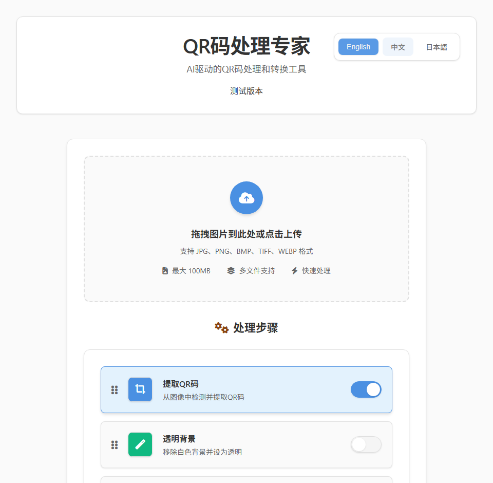
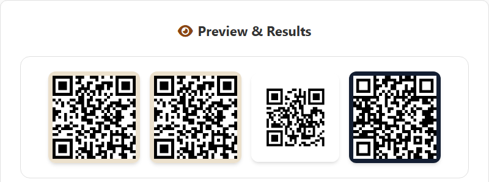

# QR

上传带二维码的图片，得到裁好的二维码，以及透明背景、SVG、反色三个版本。

| 线上版首页 | 本地运行，处理 [example-input.png](docs/assets/example-input.png) 的结果 |
|---|---|
|  |  |

右图是真实运行输出，从左到右依次为原色裁切、透明背景、SVG、反色。透明背景版放在白色页面上，看起来和原色裁切一样，区别在于它的白色像素是透明的。

## 状态与限制

- **状态**：测试版个人项目，没有测试用例，没有发布版本；最近一次功能性提交在 2025-11-08（加入 Docker 配置）。
- **线上版**：<https://qr-five-theta.vercel.app> 的首页能打开，但 2026-10-20 实测处理请求返回 404，暂时不能用。请在本地运行或用 Docker（见下）。
- **适用范围**：处理图片里的二维码，一张图里有几个码就各出一份。SVG 版是按识别出的内容重新生成的标准二维码，不保留原图的颜色、logo 和样式，需要保留原样式的矢量化不适合用它。
- **依赖与平台**：Python 3，以及 Flask、OpenCV、Pillow、pyzbar、qrcode；Linux 需另装系统库 `libzbar0`。本次在 Windows 11 + Python 3.13 上实测通过，Docker 镜像基于 Python 3.11。
- **数据去向**：图片上传到你自己运行的 Flask 服务，代码不保存上传的图片和处理结果，结果以 data URL 直接返回浏览器；服务端日志会打印每个二维码内容的前 50 个字符。线上版同理，图片会发到 Vercel 上的服务。网页从 jsDelivr 加载图标和拖拽排序脚本。

## 安装并运行

```bash
git clone https://github.com/RZX00/QR.git && cd QR
pip install -r requirements.txt     # Linux 先执行：sudo apt install libzbar0
python launcher.py
```

然后在浏览器手动打开 <http://127.0.0.1:53123>。首次启动在本机约需 10 秒。

`launcher.py` 会自动打开 `http://127.0.0.1:5000`，那个端口没有服务，浏览器会提示打不开，忽略即可（见「已知问题」）。

用 Docker 运行（本次未在本机构建验证）：

```bash
docker compose up -d      # 访问 http://localhost:53123
```

## 第一次使用

1. 打开 <http://127.0.0.1:53123>，右上角选「中文」。
2. 把 [docs/assets/example-input.png](docs/assets/example-input.png)（一张合成的海报图，二维码内容是本仓库地址）拖进上传区。
3. 打开要用的步骤开关，点「开始处理」。默认只开「提取QR码」，它必须开着，否则不输出任何结果。

四个步骤全开时，得到 4 个文件，每个都有「下载」按钮（目前只能逐个下载）：

| 文件 | 内容 |
|---|---|
| `qr_code_1.png` | 按识别框外扩 5% 裁出的二维码 |
| `qr_code_1_transparent.png` | 同上，近白色像素（R、G、B 都不低于 240）设为透明 |
| `qr_code_1.svg` | 用识别出的内容（本例是 `https://github.com/RZX00/QR`）重新生成的标准二维码 |
| `qr_code_1_inverted.png` | 裁切图的黑白反色 |

不用网页，直接调接口（在仓库根目录执行）：

```bash
curl -X POST -F "files=@docs/assets/example-input.png" \
  -F 'options={"activeSteps":["extract","svg"]}' \
  http://127.0.0.1:53123/api/process
```

返回 JSON，`files` 数组里每项含 `name`、`type`、`data`（图片是 data URL，SVG 是文本）和 `qr_data`（二维码内容）。`activeSteps` 可选 `extract`、`transparent`、`svg`、`invert`。

## 四个步骤各做什么

| 步骤 | 做法 |
|---|---|
| 提取QR码 | 用 pyzbar 识别；识别不到时，把灰度图反色再试一次（黑底白码），成功则用反色后的图裁切；按识别框外扩 5% 裁出 |
| 透明背景 | 把 R、G、B 都不低于 240 的像素设为透明；非白色背景（例如示例图里的米色）不会被去掉 |
| 转换为SVG | 不是描摹，是用识别出的内容重新生成二维码（纠错级别 L，四格边距），原图样式不保留 |
| 颜色反转 | 对裁切图逐像素取反 |

各步骤彼此独立，不叠加，不会生成「透明背景的反色版」；页面里拖动步骤只改变结果的排列顺序。识别只尝试原图和反色两次，没有放大、去噪等预处理，所以图片模糊或二维码被截断时会识别不到。

## 配置

- `launcher.py` 固定使用 `127.0.0.1:53123`，启动时会覆盖环境变量 `HOST`、`PORT`，用环境变量改不了。
- 要换端口，或让局域网内其他设备访问：`PORT=8080 python api/index.py`（Windows PowerShell：`$env:PORT=8080; python api/index.py`）。这种方式默认监听 `0.0.0.0:5000`，即所有网卡；只想本机访问就加 `HOST=127.0.0.1`。
- 上传上限在后端是 50 MB（`api/index.py` 的 `MAX_CONTENT_LENGTH`）；支持 png、jpg、jpeg、bmp、tiff、tif、webp，其他扩展名的文件会被直接跳过。

## 已知问题

- `launcher.py` 打印和监听的是 53123，却自动打开 5000 端口的地址，需要手动改访问 53123。
- 线上版的 `/api/process` 返回 404；仓库里没有 Vercel 的路由配置，只有 `/api` 能访问，疑为原因。
- 页面写「最大 100MB」，后端实际上限是 50 MB。
- 同时处理多张图片时，结果都叫 `qr_code_1.png` 这类名字，不带原图名，分不出来源。
- 提示语「Found N QR codes」里的 N 是输出文件数，不是二维码数（上面的例子只有一个二维码，却显示 4）。
- `使用说明.txt`、`CLAUDE.md`、`AGENTS.md` 里有已过期的内容（EXE 打包、`vercel.json`、5000 端口、已删除的 `image/` 样图），以本 README 为准。

## 项目结构

```
launcher.py          本地入口：启动 Flask 服务
api/index.py         Flask 后端：识别、裁切、转换
public/index.html    网页界面（单文件，英文、中文、日文）
requirements.txt     Python 依赖
Dockerfile           镜像：python:3.11-slim + libzbar0 + gunicorn，监听 53123
docker-compose.yml   一键运行 Docker 版
docs/assets/         README 用的截图和示例输入
```

## 许可证与贡献

MIT，见 [LICENSE](LICENSE)。欢迎提交 Issue 和 Pull Request。
